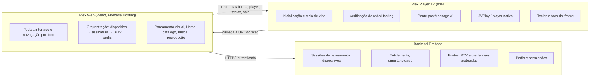
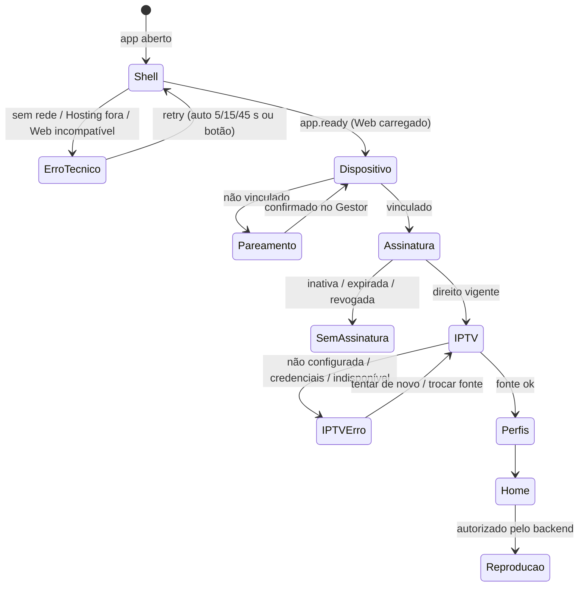

# Arquitetura oficial — iPlex Player TV × iPlex Web × Backend

Esta é a fonte de verdade da divisão de responsabilidades. Os outros
documentos (TIZEN, IPLEX-WEB, MAPA-DE-TELAS, PUBLICACAO) detalham partes
dela.

| Projeto | Repositório | Situação neste Mac (19/10/2026) |
|---|---|---|
| **iPlex Player TV** | `aliens-syndicate-iplex-app` (este) | presente: implementado e validado na Samsung |
| **iPlex Web** | outro repositório (React, Firebase Hosting `iplex-2c8fc`) | **ausente**: só a configuração de Hosting foi preparada (HOSTING.md) |
| **Backend** | Firebase `iplex-2c8fc`: Functions do Gestor (codebase `iplex-gestor`, callable `manager` com App Check) | código presente no repositório do Gestor, só lido; nenhuma consulta do Web implementada |
| **iPlex Gestor** | `aliens_syndicate_iplex_control` (`com.alienssyndicate.iplex_control`) | presente; só lido. Não deve ser alterado nem ter seu ID reutilizado |

## 1. Fronteira de responsabilidades

**O shell (este repositório) contém só:**
- inicialização, detecção de plataforma e capacidades;
- carregamento do Web;
- falhas de rede e de Hosting (telas técnicas T1–T9);
- teclas;
- ciclo de vida (suspensão, retomada, encerramento);
- player nativo;
- a ponte versionada.

**O shell não contém:**
- Home, catálogo, busca, perfis, favoritos, histórico, recomendações;
- regras de assinatura ou de família;
- credenciais IPTV;
- acesso ao Firestore;
- regras de negócio.

**O Web:**
- é toda a interface e a orquestração;
- **não** trata dados do shell como prova de nada. A identidade e o acesso
  são decididos pelo backend.

**O backend:**
- autentica, autoriza e protege credenciais;
- aplica limites;
- invalida sessões.

## 2. Fluxo oficial de inicialização

| Etapa | Responsável | O que acontece | Situação |
|---|---|---|---|
| 1. Shell | **TV** | Detecta plataforma e capacidades, verifica a rede, confere o manifesto do Web e carrega o Web. Se falhar, mostra as telas T3–T8 com retry controlado | **Implementado e testado na TV** |
| 1b. Handshake | TV + Web | O Web chama `app.ready` e recebe `PlatformInfo`. Só então o shell exibe o Web | Implementado e testado com a página de teste. O iPlex Web real ainda não existe |
| 2. Dispositivo | Web + backend | Valida o vínculo. Se não houver vínculo, inicia o pareamento com sessão real (QR + código), confirmado pelo Gestor | **Não implementado** (Web e backend ausentes) |
| 3. Assinatura | Web + backend | Consulta o entitlement real. `paymentsEnabled=false` **não** libera reprodução | **Não implementado** |
| 4. IPTV | Web + backend | Fontes autorizadas e selecionada; verificação por tipo de fonte | **Não implementado** |
| 5. Perfis | Web + backend | Perfis autorizados, visitante, regras infantis | **Não implementado** |
| 6. Uso | Web + backend + TV | Revalidações, autorização a cada reprodução, simultaneidade. A TV toca a mídia pela ponte | Só a parte da TV (player) está implementada |

## 3. Taxonomia de estados de erro

Cada estado tem uma origem própria. O Web nunca deve confundir um com outro,
por exemplo tratar IPTV fora do ar como assinatura expirada.

| Estado | Origem | Código | Tela |
|---|---|---|---|
| Sem rede | Shell | `E-OFFLINE` | T3 (shell) |
| Hosting fora do ar | Shell | `E-UNREACHABLE` | T4 |
| Web não publicado ou soft 404 | Shell | `E-NOT-DEPLOYED` | T5 |
| Hosting com erro 5xx | Shell | `E-SERVER-<status>` | T6 |
| Versão do Web incompatível | Shell (manifesto) ou ponte (`unsupported_version`) | `E-BRIDGE-VERSION` | T7 |
| Web não iniciou | Shell | `E-LOAD-TIMEOUT` | T8 |
| Dispositivo não vinculado | Backend | `DEVICE_NOT_PAIRED` (proposta) | Web: pareamento |
| Sessão inválida/expirada | Backend | `SESSION_INVALID` | Web: reautenticação |
| Assinatura inativa | Backend | `SUBSCRIPTION_INACTIVE` (+ motivo: expirada, revogada, bloqueada) | Web |
| IPTV não configurada | Backend | `IPTV_NOT_CONFIGURED` | Web |
| IPTV com credenciais inválidas | Backend | `IPTV_AUTH_FAILED` | Web |
| IPTV temporariamente indisponível | Backend | `IPTV_UNAVAILABLE` | Web (recuperável) |
| Stream específico indisponível | Backend ou player (`player.error`) | `STREAM_UNAVAILABLE` / `player_error` | Web (no player) |
| Falha de conexão com o backend | Web | `NETWORK_ERROR` | Web (recuperável) |

Os códigos `E-*` estão implementados no shell. Os demais são **propostas**
para o backend e o Web.

## 4. Contrato TV ↔ Web (implementado): ponte `iplex-bridge` v1

- **Fonte:** [`src/bridge/protocol.ts`](../src/bridge/protocol.ts).
- **Cliente de referência:** [`src/bridge/client.ts`](../src/bridge/client.ts).
- **Testes:** `src/bridge/host.test.ts`.

| Sugestão da especificação | Contrato existente |
|---|---|
| `platform.ready` | `app.ready` (handshake obrigatório, retorna `PlatformInfo`) |
| `platform.capabilities` | `platform.getInfo` / retorno do `app.ready` |
| `player.load` | `player.open` |
| `player.play` / `pause` / `stop` / `seek` | iguais |
| `player.state` / `player.error` | eventos iguais (+ `player.buffering`, `player.time`, `player.ended`, `player.subtitle`) |
| `remote.key` | evento `remote.key` (tecla recebida pelo shell) + `PlatformInfo.keys` (códigos reais para o `keydown` no Web) |
| `app.suspend` / `app.resume` | evento `app.visibility { visible }` |

`PlatformInfo` traz:
- plataforma, versão do sistema e do app;
- **ponte** (versão e métodos disponíveis);
- `installationId`;
- modelo e tela;
- mapa de teclas;
- capacidades (player nativo, encerramento, teclas de mídia).

Segurança da ponte:
- aceita só o iframe e a origem exata;
- aceita só métodos da lista;
- valida os parâmetros (mídia só `http(s)`, números ≥ 0);
- responde `unsupported_version` a outra versão;
- envia respostas só à origem exata.

Regra de evolução da ponte:
- campos e métodos **novos** mantêm a v1. O Web detecta pelo
  `PlatformInfo.bridge.methods`;
- mudanças **incompatíveis** exigem `BRIDGE_VERSION` + 1, junto com o
  `bridgeVersion` do manifesto `iplex-web.json`. Com versões diferentes, o
  shell mostra T7.

## 5. Contratos Web ↔ Backend (propostas; não implementados aqui)

O shell não fala com o backend. O que segue é o que o Web e o backend
precisam combinar, escrito para orientar esses dois projetos.

### Identidade e pareamento

- O shell fornece `installationId`: um UUID aleatório, persistente até
  desinstalar. Serve **só como dica**.
- A **prova de identidade** é uma credencial emitida pelo backend no
  pareamento. Sugestão: dispositivo autenticado no Firebase Auth via *custom
  token*, com *claims* `deviceId` e `familyId`, aplicados pelas regras do
  Firestore e pelas Functions.
- Etapas da sessão de pareamento:

  | Etapa | Quem | O que acontece |
  |---|---|---|
  | Criar | Web → backend | Cria a sessão com `installationId`, plataforma, modelo e versão do app |
  | Retorno | Backend → Web | `sessionId`, código curto, URL do QR, `expiresAt` e token de consulta. Sessão de **uso único** e TTL curto |
  | Confirmar | Gestor | Confirma pelo fluxo autenticado dele. O backend vincula o dispositivo à família |
  | Consultar | Web | Consulta ou escuta o status: pendente, confirmado, expirado ou cancelado. Ao confirmar, recebe a credencial do dispositivo |
  | Revogar | Backend | Desvincular no Gestor invalida a credencial, e o Web volta ao pareamento |

- **Reinstalação:** o `installationId` muda, então o dispositivo precisa ser
  pareado de novo. Alternativa: usar o DUID da Samsung
  (`webapis.productinfo.getDuid()`), que exige o privilégio `productinfo` e
  envolve uma decisão de privacidade. **Não está em uso.**
- **Armazenamento:** a credencial fica no armazenamento do Web (origem do
  Hosting, dentro do iframe). Nada de segredo no bundle. Em Chromium recente
  (Tizen 8+), o armazenamento de iframe é particionado pelo app, mas continua
  persistente. Validar ao implementar.

### Assinatura (entitlement)

- Consulta autenticada → `{ status, playbackAllowed, maxStreams, reason, checkedAt }`.
- Backend inacessível ⇒ **sem acesso privilegiado** (falha fechada).
  `paymentsEnabled=false` significa só "checkout indisponível".

### IPTV

- Fontes autorizadas → `[{ id, type, name, configured, selected }]`.
- Verificação de uma fonte, feita no servidor:
  `{ status: ok | auth_failed | catalog_unavailable | unreachable }`.
- Reprodução: o Web pede ao backend uma **autorização por reprodução**, que
  checa simultaneidade e perfil e devolve uma URL de stream de curta duração.
  O Web entrega essa URL ao player pela ponte (`player.open`). Credenciais
  IPTV **nunca** chegam ao bundle Web nem ao shell.

### Perfis

- Perfis autorizados com o tipo (adulto, infantil, visitante). Um perfil
  revogado é recusado pelo backend em toda consulta protegida.

## 6. Hosting (decidido)

- **Site:** `iplex-2c8fc` (`DEFAULT_SITE`), no projeto `iplex-2c8fc`.
- **URL de produção:** `https://iplex-2c8fc.web.app/`, na raiz do site, já
  configurada em `.env.production`. Ainda não há publicação.
- O domínio `alienssyndicate.com` (Core, projeto `aliens-syndicate-docs`)
  **não é usado** pelo Player e não foi alterado.
- O `firebase.json`, a CSP, o cache e o probe estão em [HOSTING.md](HOSTING.md).
  A regra "sem `X-Frame-Options` e sem `frame-ancestors`" foi verificada na TV.
- Um domínio próprio, por exemplo um subdomínio conectado ao `iplex-2c8fc`, pode ser
  adotado depois. Basta trocar a URL em `.env.production`.
