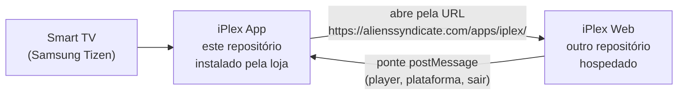
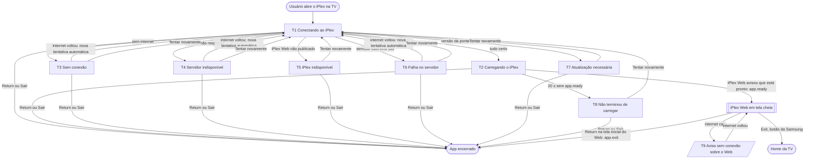
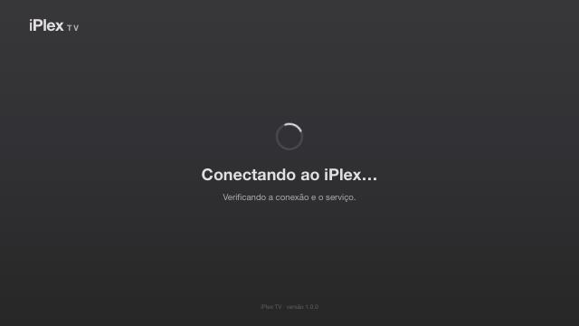
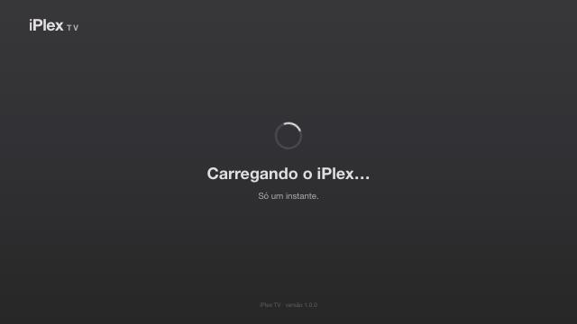
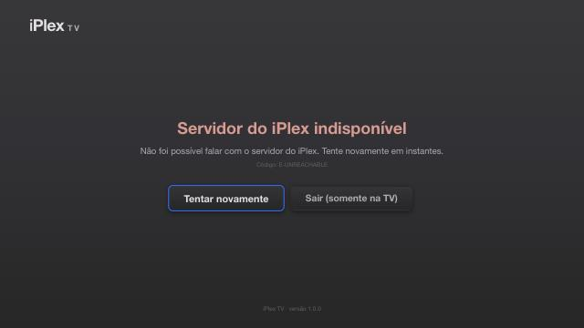
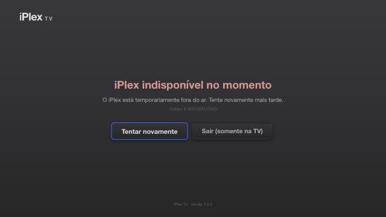
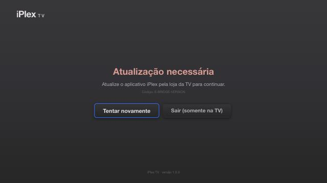
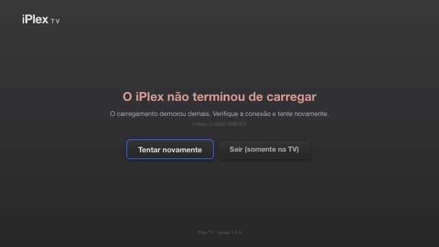
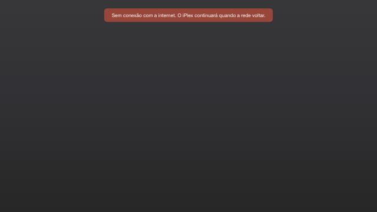

# Mapa de telas e funções — iPlex App (versão das lojas)

Este documento lista **tudo o que o app instalado na TV mostra e faz**. Ele
serve para criar o layout e também como base do *App UI Description*, que a
Samsung exige no Seller Office.

## 1. Dois projetos



| | **iPlex App** (este repositório) | **iPlex Web** (outro repositório) |
|---|---|---|
| O que é | "Casca" instalada na TV pela loja | A interface do iPlex |
| Quando aparece | Na abertura e quando algo falha | Durante todo o uso normal |
| Telas | 9 telas de sistema (abaixo) | Todas as telas do produto: início, catálogo, busca, reprodução, conta, configurações… |
| Recursos da TV | Tem acesso direto (Tizen, AVPlay) | Usa pela ponte |
| Atualização | Nova versão na loja (aprovação da Samsung) | Deploy no servidor, sem passar pela loja |

O app tem **poucas telas, de propósito**: tudo o que muda com frequência fica
no Web, que é atualizado sem nova aprovação da loja. Se uma tela pertence ao
produto, ela é do Web.

## 2. Fluxo de navegação do app



## 3. Anatomia comum das telas T1–T8

Todas as telas do app usam a mesma estrutura, em 1920×1080:

```
┌─────────────────────────────────────────────────────────────┐
│ [iPlex TV]  ← marca (canto superior esquerdo)               │
│                                                             │
│                     (◌)  ← indicador de carregamento (T1/T2)│
│                 TÍTULO DA TELA                              │
│        Mensagem para o usuário (1–2 linhas)                 │
│              Código: E-XXXX  ← só nas telas de erro         │
│                                                             │
│      [ Tentar novamente ]   [ Sair ]  ← botões (erros)      │
│                                                             │
│                 iPlex TV · versão 1.0.0  ← rodapé           │
└─────────────────────────────────────────────────────────────┘
```

| Elemento | Hoje | Observação para o layout |
|---|---|---|
| Fundo | Gradiente grafite `#403E41` → `#39373C` → `#2C2C2C` | Paleta do app Flutter do iPlex |
| Marca | Wordmark tipográfico "iPlex" + "TV" | Trocar pelo logo oficial quando houver o arquivo |
| Carregamento | Círculo girando | Pode virar animação com o logo |
| Título | 2,8vw, peso 700; nas telas de erro, em tom avermelhado `#E8A19B` | |
| Mensagem | 1,5vw, `#B5B4B6` | Texto para o usuário final |
| Código | 1vw, `#6B696B` | Ajuda o suporte. Em desenvolvimento mostra o detalhe técnico |
| Botões | Borda azul `#007AFF` e escala 1,06 no foco | Navegação ←/→ entre os botões |
| Rodapé | "iPlex TV · versão X" | Em desenvolvimento mostra ambiente, destino e plataforma |
| Margens | 5% nas bordas | Área segura contra o *overscan* da TV |

Controle remoto em T1–T8:

| Tecla | Efeito |
|---|---|
| ← / → (e ↑ / ↓) | Move o foco entre os botões |
| OK | Aciona o botão em foco |
| Return | Encerra o app (Samsung: na tela inicial, o Return pode encerrar o app) |
| Exit | Comportamento padrão da TV (volta à Home). O app não trata essa tecla |

## 4. Telas do app

Para ver qualquer tela no navegador, rode `npm run dev` e abra
`http://localhost:5173/launcher.html?screen=<id>`. Para ver com o rodapé de
produção, use a configuração `iplex-dev-production-url` de
`.claude/launch.json` (porta 5177). A pré-visualização existe **só em
desenvolvimento** e não entra no pacote da loja.

### T1 — Conectando ao iPlex · `?screen=checking`



- **Quando aparece:** logo ao abrir o app, enquanto ele verifica a internet e
  confere o manifesto `iplex-web.json` do iPlex Web. A espera vai até 8 s.
- **Textos:** "Conectando ao iPlex…" / "Verificando a conexão e o serviço."
- **Ações:** nenhum botão. Return encerra o app.
- **Saídas:** T2, T3, T4, T5, T6 ou T7.

### T2 — Carregando o iPlex · `?screen=loading`



- **Quando aparece:** o serviço está no ar e o iPlex Web está carregando por
  trás desta tela.
- **Textos:** "Carregando o iPlex…" / "Só um instante."
- **Ações:** nenhum botão. Return encerra o app.
- **Saídas:**
  - o iPlex Web aparece quando chama `app.ready`;
  - T8, se o `app.ready` não chegar em 20 s.

### T3 — Sem conexão com a internet · `?screen=offline` · código `E-OFFLINE`


- **Quando aparece:** a TV está sem internet.
- **Textos:** "Sem conexão com a internet" / "Verifique a conexão da TV. O
  iPlex tentará novamente quando a conexão voltar."
- **Ações:** **Tentar novamente** e **Sair**. Quando a internet volta, o app
  tenta de novo sozinho.

### T4 — Servidor do iPlex indisponível · `?screen=unreachable` · `E-UNREACHABLE`



- **Quando aparece:** a TV tem internet, mas o servidor do iPlex não responde
  (fora do ar ou tempo esgotado).
- **Textos:** "Servidor do iPlex indisponível" / "Não foi possível falar com o
  servidor do iPlex. Tente novamente em instantes."
- **Ações:** **Tentar novamente** e **Sair**. Também tenta de novo sozinho
  quando a rede volta.

### T5 — iPlex indisponível no momento · `?screen=not-deployed` · `E-NOT-DEPLOYED`



- **Quando aparece:** o servidor responde, mas o iPlex Web não está lá. Os
  casos são: manifesto ausente ou sem CORS, uma página do site no lugar do
  manifesto (*soft 404*), ou HTTP 404.
- **Hoje:** é a tela que a TV mostra em produção, porque `/apps/iplex/` ainda
  não está publicado. Isso foi verificado no aparelho.
- **Textos:** "iPlex indisponível no momento" / "O iPlex está temporariamente
  fora do ar. Tente novamente mais tarde."
- **Ações:** **Tentar novamente** e **Sair**. Serve também como tela de
  manutenção.

### T6 — Servidor do iPlex com falha · `?screen=server-error` · `E-SERVER-<status>`


- **Quando aparece:** o servidor responde com erro HTTP 5xx.
- **Textos:** "Servidor do iPlex com falha" / "O servidor do iPlex está com
  problemas. Tente novamente em instantes."
- **Ações:** **Tentar novamente** e **Sair**. Também tenta de novo sozinho
  quando a rede volta.

### T7 — Atualização necessária · `?screen=incompatible` · `E-BRIDGE-VERSION`



- **Quando aparece:** o iPlex Web publicado usa uma versão da ponte diferente
  da deste app (`bridgeVersion` no manifesto).
- **Textos:** "Atualização necessária" / "Atualize o aplicativo iPlex pela
  loja da TV para continuar."
- **Ações:** **Tentar novamente** e **Sair**.

### T8 — O iPlex não terminou de carregar · `?screen=load-timeout` · `E-LOAD-TIMEOUT`



- **Quando aparece:** o iPlex Web carregou, mas não chamou `app.ready` em 20 s.
- **Textos:** "O iPlex não terminou de carregar" / "O carregamento demorou
  demais. Verifique a conexão e tente novamente."
- **Ações:** **Tentar novamente** e **Sair**.

### T9 — Aviso de sem conexão durante o uso · `?screen=offline-banner`



- **Quando aparece:** a internet cai com o iPlex Web já aberto. A faixa fica
  no topo, sobre o Web, e some quando a rede volta.
- **Texto:** "Sem conexão com a internet. O iPlex continuará quando a rede
  voltar."
- O iPlex Web também recebe o evento `network.status` e pode mostrar o seu
  próprio aviso. Nesse caso, combinar para não aparecerem dois.

### Telas que existem só em desenvolvimento

- **Configuração inválida** (`?screen=config`, `E-CONFIG`): falta a URL ou ela
  não é HTTPS. Não ocorre num pacote de loja válido.
- **"Você voltou ao iPlex TV"** (`?screen=returned`): só existe no modo
  `navigate`, que não é usado em produção.
- **Página de teste "IPLEX TIZEN ONLINE"** (`index.html`): ferramenta de teste
  da ponte. Não entra no pacote da loja.

## 5. Funções do app sem tela

| Função | O que faz | Como o iPlex Web usa | Validação na TV (Tizen 5.5) |
|---|---|---|---|
| Verificação de disponibilidade | Rede + manifesto `iplex-web.json` (identidade, CORS, versão da ponte) | Publicar o manifesto | ok |
| Hospedagem do Web | Tela cheia, foco do controle no Web após o `app.ready` | Chamar `app.ready` | ok |
| Ponte segura | Aceita só o iframe, a origem exata, métodos da lista e parâmetros válidos | `src/bridge/client.ts` | ok |
| Informações da plataforma | Plataforma, versão do Tizen e do app, User-Agent, se há player nativo | `platform.getInfo` / retorno do `app.ready` | ok |
| Player nativo (AVPlay) | Abrir/tocar HLS, pausar, retomar, parar, buscar, estado | `player.open/play/pause/stop/seek/getStatus` | ok |
| Troca de canal | `player.open` durante a reprodução. Um pedido substituído termina na hora | `player.open` | ok (inclusive troca rápida) |
| Faixas e legendas | Lista faixas, seleciona áudio/legenda, mostra/oculta legendas | `player.getTracks/selectTrack/setSubtitlesVisible` + `player.subtitle` | ok: lista e legenda padrão. ⚠ Troca de áudio e de idioma da legenda limitada no Tizen 5.5 |
| Eventos do player | Estado, buffering, tempo, erro, fim, legenda | `player.*` | ok |
| Controle remoto | Setas, OK e Return chegam ao Web. Exit fica com o sistema | `keydown` (37–40, 13, 10009) | ok |
| Encerrar o app | Fecha o aplicativo | `app.exit` | ok |
| Multitarefa | App oculto → player parado + evento | `app.visibility` | implementado; não exercitado na TV |
| Rede durante o uso | Faixa T9 + evento | `network.status` | implementado; não exercitado na TV |

Detalhes do contrato: [`src/bridge/protocol.ts`](../src/bridge/protocol.ts) e
[IPLEX-WEB.md](IPLEX-WEB.md).

## 6. O que o layout do iPlex Web precisa prever na TV

As telas do produto são definidas no projeto Web. Do lado da TV, estes
estados precisam de layout lá:

| # | Estado no Web | Por quê |
|---|---|---|
| W1 | **Primeira tela após o `app.ready`** | Substitui T2. Evite um "segundo carregamento" visível |
| W2 | **Tela de reprodução** com fundo transparente | O AVPlay desenha o vídeo **atrás** da página. Controles e legendas ficam por cima |
| W3 | **Carregando canal / buffering** | `player.open` pode levar alguns segundos (tempo limite de 45 s). Comandos durante o carregamento devolvem `NOT_READY` |
| W4 | **Erro de reprodução** | Eventos `player.error` / `player_error`, por exemplo stream fora do ar |
| W5 | **Fim do conteúdo** | Evento `player.ended` |
| W6 | **Seleção de áudio e legenda** | Considerar as limitações do Tizen 5.5 (seção 5) |
| W7 | **Volta do segundo plano** | `app.visibility` com `visible: true`: o player foi parado, retomar ou não? |
| W8 | **Confirmar saída (opcional)** | Return na tela inicial → `app.exit`. A Samsung permite confirmação no Return, **nunca** no Exit |
| W9 | **Sem rede** | Evento `network.status`. Combinar com a faixa T9 |
| — | Foco visível em todos os itens | Navegação só por setas, sem depender de hover |

## 7. Decisões de layout pendentes (suas)

1. **Nome na TV:** hoje é "iPlex TV" (`IPLEX_TIZEN_APP_NAME`). Precisa ser
   igual ao título no Seller Office.
2. **Logo:** precisa do arquivo (`store/samsung/`). Hoje a TV mostra o
   wordmark tipográfico.
3. **Saída nas telas de erro:** hoje o Return e o "Sair" encerram na hora.
   Quer pedir confirmação?
4. **Código de erro visível:** hoje aparece discreto ("Código: E-…"). Manter?
5. **Carregamento:** usar só o círculo girando ou uma animação com o logo?
6. **Idiomas:** as telas do app estão só em pt-BR. O Seller Office pede título
   e descrição em cada idioma suportado.
